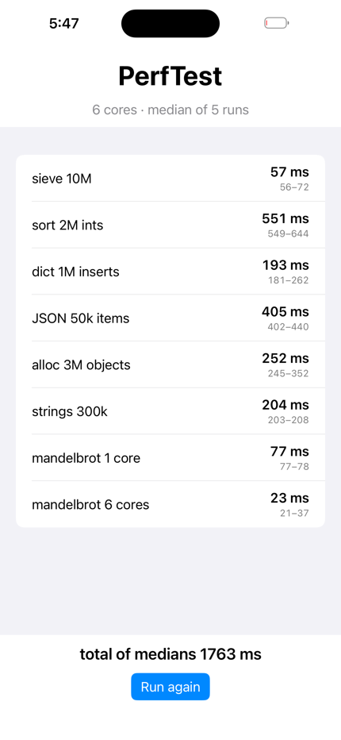

# PerfTest

A small SwiftUI app that measures how fast the VM runs guest code. At launch it runs eight
benchmarks, five times each, and shows each median with its range. The same benchmark file also
builds natively on the host, so you can compare the VM with bare metal.



| Benchmark | What it stresses |
|---|---|
| mandelbrot, 1 core | pure floating-point CPU work, no memory traffic |
| mandelbrot, all cores | the same, split across every core with `DispatchQueue.concurrentPerform` |
| sieve 10M | a 10 MB array touched once: fresh pages |
| dict 1M inserts | hash-table growth: allocation and fresh pages |
| sort 2M ints | the standard library's sort |
| JSON 50k items | Foundation's `JSONEncoder`/`JSONDecoder` |
| alloc 3M objects | the system allocator (malloc) and reference counting |
| strings 300k | string formatting, splitting and case mapping |

## Run it in the VM

Set up xtool and the iOS SDK as described in [docs/APP-DEVELOPMENT.md](../../docs/APP-DEVELOPMENT.md).
Then, with the VM running:

```sh
cd examples/PerfTest
xtool dev build --ipa --configuration release
../../tools/install-ipa.py xtool/PerfTest.ipa --launch com.example.PerfTest --cid 3
```

The results appear after about 10 s. **Run again** repeats the benchmarks. They are also logged
under the subsystem `com.example.PerfTest`.

## Run it on the host

```sh
examples/PerfTest/host/build.sh && examples/PerfTest/host/perftest-host
```

## Results

Measured 2026-11-25 on an M1 Pro on battery: the VM under KVM (6 vCPUs, iOS 26.6.2), and the same
Mac natively (Linux, 8 cores, Swift 6.4.2). Each value is the median of 5 runs in ms, with the
range in brackets.

| Benchmark | iOS VM (KVM) | Host Linux |
|---|---|---|
| mandelbrot, 1 core | 77–78 (77–78) | 77 (77–78) |
| mandelbrot, all cores | 23 (20–42), 6 cores | 14 (12–15), 8 cores |
| sieve 10M | 57–69 (50–141) | 28 (28–32) |
| dict 1M inserts | 177–193 (176–262) | 61 (60–63) |
| JSON 50k items | 405–449 (402–562) | 221 (221–226) |
| sort 2M ints | 490–551 (479–644) | 722 (722–727) |
| alloc 3M objects | 251–252 (245–352) | 305 (304–305) |
| strings 300k | 204–223 (203–283) | 351 (350–352) |
| total of medians | 1761–1763 | 1783 |

The VM column gives the medians from two app launches.

- **CPU-bound code runs at native speed under KVM.**
- **Touching new memory is 2–3× slower than native.** A fresh guest page goes through the GXF
  page-table emulation and a stage-2 fault. The VM's wide ranges come from the same cost.
- **The last four rows compare Apple's libraries in the guest with Linux's on the host.** They
  aren't a measure of emulation overhead.

On an x86_64 host, the guest runs under TCG instead, and every benchmark is slower than native.
